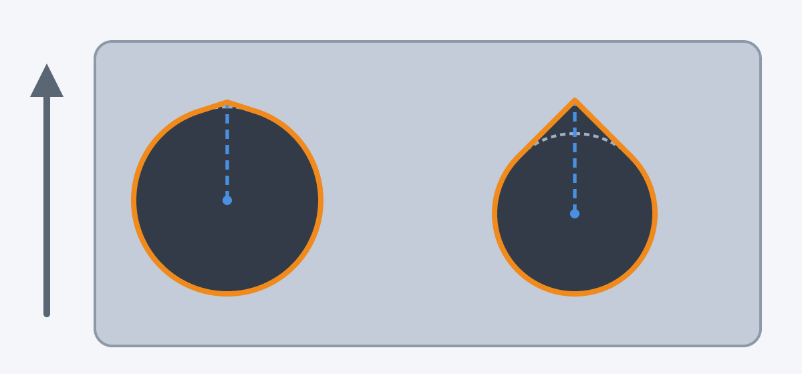
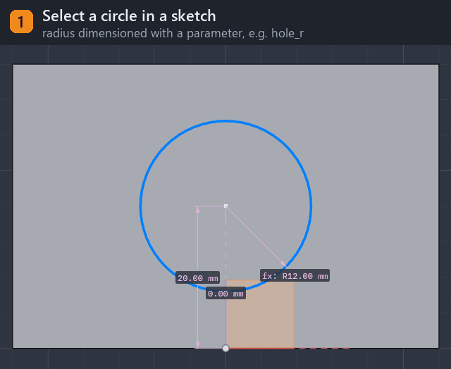

# 3D Printing Holes – SolidCraft plugin

Holes that print well. First feature: **Teardrop**.



A horizontal hole in a vertical wall has a flat ceiling that sags when it is printed.
The teardrop replaces that ceiling with two tangent flanks that meet in a small tip.
By default the tip sits only **2.5 % of the diameter** above the circle. That is enough to make up for
the sag, and the hole stays practically round. The classic 45° teardrop is still available.

## Usage



1. In a sketch, draw a normal circle and dimension it, e.g. radius `hole_r`.
2. Press **Esc** to end the active sketch tool and select the circle (hold Shift for several).
3. Open **Plugins › 3D Printing Holes › Teardrop…** (or **Model › Plugins › Teardrop** in the ribbon).
4. Check the fields in the form, press **Run** and approve the package the first time.

The circle's sketch does not need to be open. If the selected circle belongs to a different sketch
than the one being edited (SolidCraft reports it as `external_sketch_curve`), the plugin closes the active
sketch, converts the circle in its own sketch and then reopens the sketch you were in.

If the plugin finds no selected circle, the error message says what was selected instead.
Alternatively, tick **Apply to all circles in sketch** to convert every circle of the open sketch without selecting anything.

SolidCraft builds the form itself from the input schema in the manifest.
The whole run is a single undo step.

The circle becomes an arc around the old centre plus two tangent flanks up to the tip.
The result is ordinary, constrained sketch geometry:

- **Construction line centre → tip:** shows permanently in the sketch where "up" is.
- **Radius:** the circle's radius or diameter dimension moves to the arc together with its expression. Change the parameter and the whole teardrop follows.
- **Tip:** held by a length dimension with an expression that keeps the percentage visible, e.g. `hole_d / 2 + hole_d * 2.5 / 100` (or `hole_r + 2 * hole_r * 2.5 / 100` for a radius dimension). Edit the `2.5` there to change one hole afterwards; when the size changes the tip moves with it, without running the plugin again.

### Form fields

In the order the form shows them:

| Field | Default | Meaning |
|---|---|---|
| **Apply to all circles in sketch** (`apply_to_all`) | off | Off = only the selected sketch circles; on = all (non-construction) circles of the open sketch |
| **Tip above circle (% of Ø)** (`tip_extra_d`) | `2.5` | How far the tip rises above the circle, in percent of the diameter: the hole gets that much taller at the top |
| **Override: tip from centre** (`tip_height`) | empty | Empty = use **Tip above circle**. Set = replaces it with the distance from the centre (not from the circle) to the tip, in mm or as an expression with `r` = radius and `d` = diameter, e.g. `d/2 + 0.3 mm` or `d*sqrt(2)/2` (classic 45°) |
| **Tip direction** (`up`) | `world +Z (print up)` | Direction of the tip: `world +Z (print up)` = world +Z projected into the sketch plane (the usual print direction); `sketch +X`, `sketch -X`, `sketch +Y`, `sketch -Y` = the sketch's own axes; `angle in sketch` = the angle from **Tip angle in sketch** |
| **Tip angle in sketch (deg)** (`up_angle`) | `90` | Only with Tip direction = `angle in sketch`: angle in degrees from sketch +X, counter-clockwise (90 = sketch +Y) |
| **Warn on horizontal sketch** (`warn_horizontal`) | on | Warn when Tip direction = `world +Z` finds no direction on a horizontal sketch (see below) |

Script/CLI only (not in the form): `tip_extra` (older form of `tip_extra_d`, in percent of the radius; `tip_extra_d` wins), `scope` (older form of `apply_to_all`: `"selected"` or `"all in sketch"`), `circles` (circle ids `"c1"` or `{id, sketch}`, empty = selection) and `sketch` (sketch id/name when no sketch is open).
There, `up` also takes an angle directly, e.g. `"300"`, and the older values `auto`, `+x`, `-x`, `+y`, `-y`, `angle`. `overhang_angle` (degrees from the horizontal) builds the teardrop with an angle constraint instead of the height and takes precedence over `tip_extra_d`.

### Formulas

- Default: **h = r + d·p/100** with p = `tip_extra_d`, i.e. **h = 1.05·r** at 2.5 %. The hole is d·(1 + p/100) tall.
- The flanks touch the circle at the angle φ = acos(r/h) from "up" (at 2.5 %: φ ≈ 17.8°) and are inclined φ to the horizontal.
  So the tip only bridges a short chord of 2·r·sin φ (≈ 0.61·r) instead of the whole hole width.
- Area: r²·(π − φ) + r·h·sin φ; at 2.5 % that is only ≈ 0.3 % more than the circle.
- Classic with overhang angle α: h = r / cos(α), so h = r·√2 ≈ 1.414·r at 45°.

The sag is more of a fixed distance (one or two layer heights) than a fraction of the diameter.
For very large or very small holes an expression like `tip_height = d/2 + 0.3 mm` is often a better fit.

**Horizontal sketches:** the CAD orientation is not always the print orientation.
On a horizontal sketch, Tip direction = `world +Z (print up)` gives no direction, so the tip points to sketch +Y.
The plugin warns about it; with **Warn on horizontal sketch** = off it stays quiet.
If the part is printed in a different orientation than it is modelled, set Tip direction to a sketch axis or an angle.

Constraints that were attached to the circle (e.g. tangent to something) are lost; the plugin reports them as a warning.
It is best to convert the circle before extruding.

## Install

Download `solidcraft-3d-printing-holes.zip` from the [latest release](../../releases/latest), or build it yourself (see below).

- **GUI:** *Plugins › Install plugin…* (or *Preferences › Plugins*) and choose the zip. An installed older version is replaced.
- **Manual:** copy the folder `solidcraft-3d-printing-holes/` from the zip to `%LOCALAPPDATA%\SolidCraft\plugins\solidcraft-3d-printing-holes\` and restart SolidCraft.

Without the GUI (script, MCP, agent chat, CLI) run it with `plugin.inspect` (returns the approval hash) followed by `plugin.run`:

```json
[{"command":"plugin.inspect","params":{"path":"dist/solidcraft-3d-printing-holes"}}]
[{"command":"plugin.run","params":{"path":"dist/solidcraft-3d-printing-holes","approval":"<hash>","entry":"teardrop","params":{}}}]
```

The menu entry and ribbon button need SolidCraft 0.42 or later.

## Build

Requirements (Windows):

- rustup; `rust-toolchain.toml` selects the `stable-x86_64-pc-windows-gnu` toolchain automatically, so no Visual Studio Build Tools are needed
- [wasm-tools](https://github.com/bytecodealliance/wasm-tools) on `PATH`

```powershell
.\scripts\build.ps1          # -> dist/solidcraft-3d-printing-holes/ and dist/solidcraft-3d-printing-holes.zip
cargo test                   # geometry and parser tests
node tests/e2e/run.mjs       # end-to-end against solidcraft-cli (headless)
```

Pushing a tag `v*` (e.g. `v0.1.0`) builds the zip on GitHub Actions and attaches it to a release
([.github/workflows/release.yml](.github/workflows/release.yml)). The tag must match the `version` in `plugin/plugin.json`.

## Layout

| File | Content |
|---|---|
| [src/geometry.rs](src/geometry.rs) | pure teardrop geometry, projection of "up" |
| [src/teardrop.rs](src/teardrop.rs) | inputs, reading the circle, creating geometry and constraints via app commands |
| [src/lib.rs](src/lib.rs) | entry dispatch and WIT bindings (`craft:plugin@0.1.0`) |
| [wit/plugin.wit](wit/plugin.wit) | pinned copy of the SolidCraft plugin WIT |
| [plugin/plugin.json](plugin/plugin.json) | manifest: entry, input schema, allowed commands |

## Inspiration

- Makers Muse: [video on YouTube](https://www.youtube.com/watch?v=j6508J94VsA)
- Slant 3D: [video on YouTube](https://www.youtube.com/watch?v=Bd7Yyn61XWQ)

## License

MIT, see [LICENSE](LICENSE).
